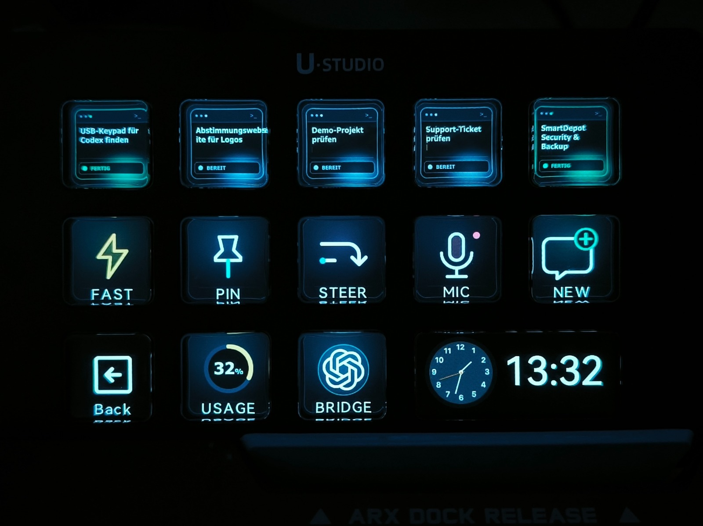
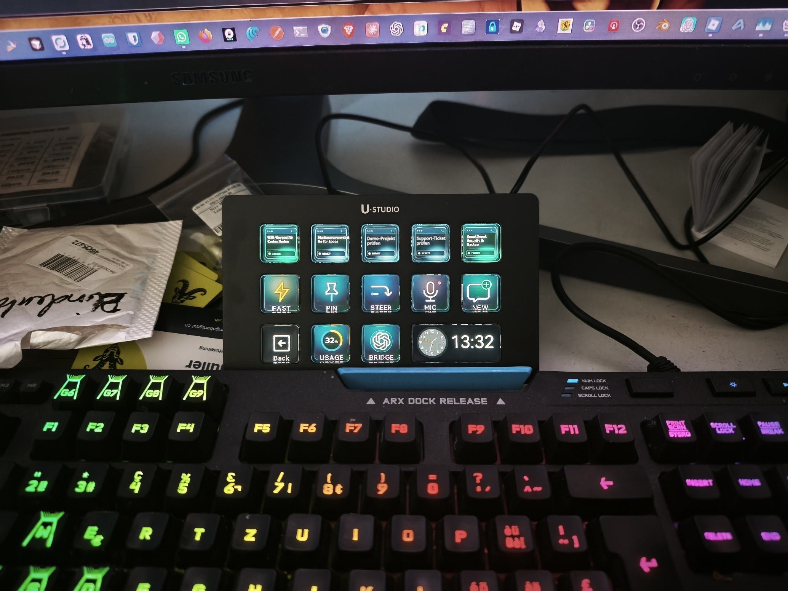
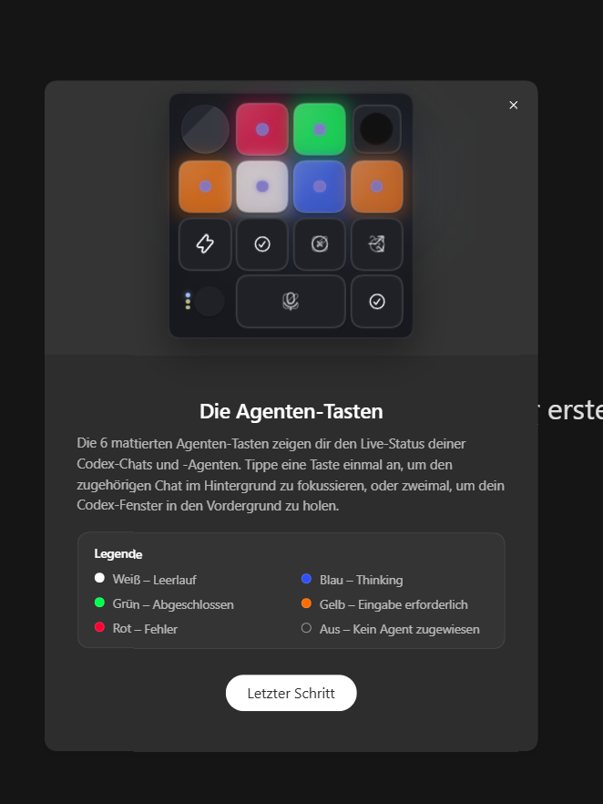

# OpenCodexMicro for Windows

> This repository is an independent abartiggut fork of
> [UlanziTechnology/OpenCodexMicro](https://github.com/UlanziTechnology/OpenCodexMicro).
> This is the abartiggut Windows 10/11 port for Ulanzi D200 Series.
> Windows development is on the `windows-port` branch. The original project
> supports macOS. This fork is not maintained or endorsed by Ulanzi or OpenAI.

**Control Codex Desktop from an Ulanzi D200 Series on Windows through Ulanzi Studio.**

[Windows setup for AI agents](docs/windows-agent-install.md) ·
[Windows operations](docs/setup-and-operations.md#windows-1011-experimental) ·
[macOS / 中文说明](README_zh.md)

OpenCodexMicro exposes Codex's live Micro state through a loopback Bridge and
turns it into a native Ulanzi Studio plugin. It shows recent tasks, switches to
the exact task displayed on a key, and provides Fast, Usage, Pin, New, Fork,
Steer, Mic, Submit, Latest Task & Scroll, and Model & Reasoning Encoder actions.



The Windows setup on a desk, with the D200 showing the same live task keys:



The chat titles on task keys 3 and 4 are anonymized in both photographs.

The task keys use small terminal windows with the current chat title and a
color-coded, written status. The five states are idle, working, done, input
needed, and error; offline is shown separately. The matching function icons
and Codex mark are included in the [icon set preview](docs/icon-set-preview.png).
Run `npm run icons:generate` to rebuild the 196 × 196 px PNGs and preview.

Codex Desktop's Windows onboarding screen explains the agent key status colors
(this screenshot shows an earlier key design):



## What it does

| Feature | Behavior |
| --- | --- |
| Five live task actions | Show Codex's Most Recent tasks with idle, working, complete, pending approval, reply needed, or error state |
| Exact task switching | Route the selected thread through Codex's own Micro event bus |
| Codex controls | Fast, Usage, Pin, New, Fork, Steer, Mic, and Submit |
| Launch Codex Bridge | On Windows, start or restart Codex with local CDP; on macOS, launch Codex Bridge.app |
| Encoder navigation | Press to open task 1; turn left/right to scroll up/down through Ulanzi Studio's hotkey protocol |
| Model & Reasoning Encoder | Turn to switch models; hold and turn to switch reasoning effort; stop at either end of each list |
| Context Navigator Encoder | First turn opens the + / @ menu; turn left/right to move up/down; click to select, hold and turn to close; clicking while closed does nothing |
| Permission Pilot Encoder | Turn to change the active chat's permission policy; during approval, select ONCE / CHAT / DENY and press to submit |
| Live usage | Draw the remaining Codex allowance directly on the key; press to return to Codex |
| Ulanzi Studio integration | Let Ulanzi Studio own the device and manage the key layout |
| Local-only transport | Bind CDP and the Bridge API to loopback addresses only |

This independent fork extends Ulanzi's unofficial Codex Desktop integration to
Windows. The original project targets macOS and Ulanzi D200 Series. Neither
Ulanzi nor OpenAI maintains or endorses this fork.

Ulanzi's implementation and maintenance scope is limited to
`integration/com.ulanzi.codexmicro.ulanziPlugin/`. The plugin only consumes
state and action interfaces exposed through the existing local Bridge; Ulanzi
did not participate in the design, specification, development, or maintenance
of CDP or Codex's CDP implementation. See [NOTICE.md](NOTICE.md) for the full
responsibility boundary.

## Installation

### Windows 10/11 (experimental)

Install Codex Desktop, Ulanzi Studio 3.4.8 or later, Git and Node.js 20 or
later. Connect the D200. Save any Ulanzi Studio profile edits and quit Studio
completely, including its tray process. In PowerShell:

   ```powershell
   git clone --branch windows-port https://github.com/abartiggut/ulanzi.git
   cd ulanzi
   npm ci
   npm run setup:windows
   ```

Restart Studio, assign **Codex Task 1–5** and **Launch Codex Bridge** from the
**Codex Micro** category, then press the Bridge key. It starts or restarts
Codex with local CDP. Check `http://127.0.0.1:17373/health`:
`codexConnected` must be `true`.

**For a coding agent:** follow [AGENTS.md](AGENTS.md) and the
[Windows agent checklist](docs/windows-agent-install.md). It covers existing
installations, the Windows setup command, languages, action routing, and
verification. The key layout is configured in Ulanzi Studio; no profile is
bundled with the repository.

The Windows port has been verified with a connected D200, Ulanzi Studio and
Bridge. Individual physical actions may still need testing on another machine.

### macOS

#### Installation environment

- macOS 13 or later;
- Codex Desktop;
- Ulanzi Studio 3.0.1 or later;
- Ulanzi D200 Series connected to Ulanzi Studio;
- Node.js 20 or newer only for repository-based manual installation.

#### 1. LLM / Agent installation

An LLM or coding agent must follow these steps:

1. Read [AGENTS.md](AGENTS.md) and inspect the installed Ulanzi Studio plugin
   manifests under `~/Library/Application Support/Ulanzi/UlanziDeck/Plugins/`.
2. Treat Codex Micro as installed only when manifest UUID
   `com.ulanzi.ulanzistudio.codexmicro` is present and its `CodePath` exists.
3. If it is missing or invalid, load
   [`$install-ulanzi-studio-plugin`](skills/install-ulanzi-studio-plugin/SKILL.md),
   install the plugin, and verify its manifest and entry point.
4. After the plugin is verified, load
   [`$setup-codex-bridge`](skills/setup-codex-bridge/SKILL.md), install or repair
   `Codex Bridge.app` and its sidecar, and verify the local health endpoint.
5. Report plugin installation and Bridge connectivity separately. Do not
   reinstall a valid plugin unless an update or repair was requested.

#### 2. Install Bridge from Ulanzi Studio

After installing the Codex Micro plugin, drag any Codex Micro action onto a
key and select it. Its shared **Codex Bridge Setup** page can:

- show whether `Codex Bridge.app`, the Bridge service, and CDP are available;
- install or repair the bundled Bridge without a repository or npm directory;
- launch `~/Applications/Codex Bridge.app`; and
- recheck the connection or open the full installation guide.

The installer writes only to the current user's Applications, Application
Support, and LaunchAgents directories and does not require `sudo`.

#### 3. Manual installation

```bash
git clone https://github.com/UlanziTechnology/OpenCodexMicro.git
cd OpenCodexMicro
npm install
npm run install:plugin
npm run setup
```

Quit Ulanzi Studio before running `npm run install:plugin`. The command
validates and atomically installs the prebuilt plugin. `npm run setup` builds
the loopback Bridge sidecar, registers its user LaunchAgent, and installs
`Codex Bridge.app` in `~/Applications`.

Reopen Ulanzi Studio. Quit Codex Desktop, then open
`~/Applications/Codex Bridge.app`; the wrapper starts Codex with a
loopback-only CDP endpoint. Confirm the connection with:

```bash
curl http://127.0.0.1:17373/health
curl http://127.0.0.1:17373/state
```

In Ulanzi Studio, drag the Codex Micro actions onto the desired keys. See
[Setup and operations](docs/setup-and-operations.md) for installed paths,
diagnostics, updates, and uninstall instructions.

> **Important:** When using Codex Micro, always launch Codex through
> `~/Applications/Codex Bridge.app`. Do not open Codex Desktop directly.
>
> Launch command:
>
> ```bash
> open ~/Applications/Codex\ Bridge.app
> ```

## Configure

The physical layout is managed in Ulanzi Studio. The plugin ships these
actions: Codex Task 1–5, Fast, Usage, Pin, New, Fork, Steer, Mic, Submit, and
Latest Task & Scroll, Model & Reasoning, and Context Navigator for Encoder controls.
No separate device daemon or shortcut mapping is required.

Select any configured action to open the shared **Codex Bridge Setup** page.
It shows Bridge installation, service, and CDP status and provides Install /
Repair and Launch controls.

The Model & Reasoning action uses the active composer's available model list
and the selected model's supported reasoning efforts. Right turns toward the
highest entry (Codex's first model), left toward the lowest (its last model).
Holding and turning right/left raises/lowers reasoning effort. Neither list wraps.
The graphic display separates model version and family, shows list position and
effort bars, and highlights reasoning while held. Pressing alone changes no selection.
Rebuild/update the Bridge as well
as the plugin when upgrading to this feature (use Install / Repair in the setup page).

Task keys mark pending approval and pending replies explicitly while keeping the
task title. They return to their normal status when Codex resumes or completes.

Context Navigator controls the composer's **Add files and more** (+ / @) menu.
The first turn opens it without skipping the initial selection. Further left/right
turns move up/down. A click confirms the highlighted item on release; holding
and turning either way closes the menu without confirming. Clicking or holding
and turning while the menu is closed does nothing. It uses structural identifiers rather than translated
button labels. Update both the plugin and Bridge when adding this feature.

On macOS, enable Ulanzi Studio in **System Settings > Privacy & Security >
Accessibility** so Encoder rotation can send mouse-wheel events.

See [Configuration](docs/configuration.md) for action behavior and layout
guidance.

For macOS, the repository includes two reusable Codex skills. Windows agents
should use [the Windows checklist](docs/windows-agent-install.md) instead:

| Skill | Purpose |
| --- | --- |
| [`setup-codex-bridge`](skills/setup-codex-bridge/SKILL.md) | Install, update, verify, or repair `Codex Bridge.app` and its sidecar |
| [`install-ulanzi-studio-plugin`](skills/install-ulanzi-studio-plugin/SKILL.md) | Install the repository's prebuilt plugin directory into Ulanzi Studio |

## Documentation

- [Configuration](docs/configuration.md)
- [Setup and operations](docs/setup-and-operations.md)
- [Architecture](docs/architecture.md)
- [Engineering constraints](docs/errors.md)

## License

Project-authored code is released under the [MIT License](LICENSE). See the
[modification and responsibility notice](NOTICE.md) for upstream attribution,
material changes, Ulanzi maintainership, independence from OpenAI, and
responsibility boundaries. Bundled and build-time dependencies are documented in
[third-party notices](THIRD_PARTY_NOTICES.md).
